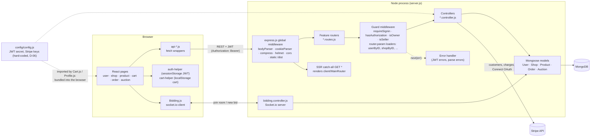
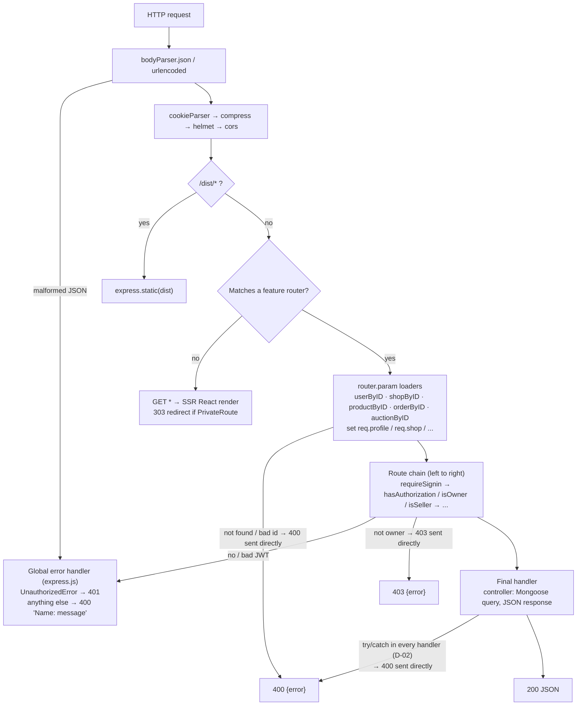
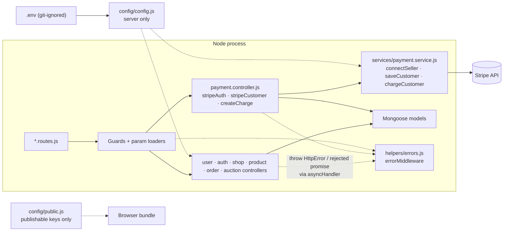
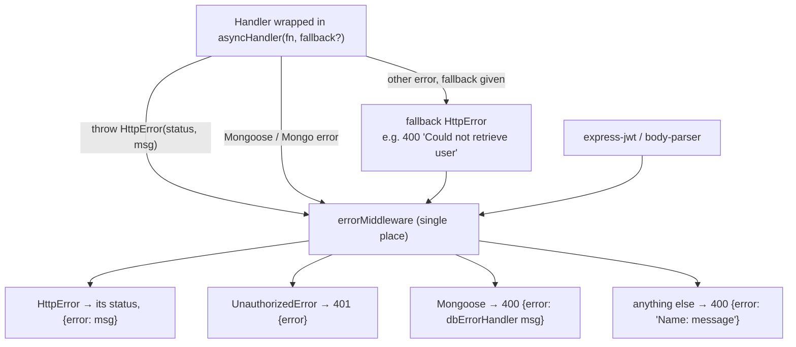

# Architecture and request lifecycle

Phase 1 (system understanding) for the backend core. Diagrams describe the original system at tag
`baseline` (commit `bf3fc45`); the last section shows the same views after the `refactor/backend-core`
changes, for the Phase 4 before/after comparison. Diagrams are Mermaid: GitHub renders them, and
<https://mermaid.live> exports PNG/SVG for the report.

## 1. Architectural style

A **layered client-server monolith**, organised **by feature** (user, auth, shop, product, order,
auction) on both sides. One Node process serves three things:

1. the REST API (`/api/*`, `/auth/*`),
2. the React app, server-side rendered for every other URL and then hydrated in the browser,
3. a Socket.io channel for live auction bidding.

Within the API, the layers are **routes → middleware chain → controller → Mongoose model → MongoDB**.
There is no service layer at baseline: controllers mix HTTP handling, business rules and data access
(D-04), and `user.controller.js` also talks to Stripe (D-03).

## 2. Component overview (baseline)



Notes:

- `config/config.js` is imported by both server and client code, so webpack shipped the whole config,
  including the Stripe secret key, to every browser (D-06).
- `client/auction/Bidding.js` opens a socket at import time, which also happens on the server during
  SSR (found while setting up tests).
- `bidding.controller.js` is not an HTTP controller: it starts the Socket.io server and writes bids to
  the database (D-05). Its `new bid` event has **no authentication**: any socket client can bid as any
  `bidder` id it sends.

## 3. Request lifecycle

### 3.1 Order of processing in Express



Two details that matter for behaviour:

- **Param loaders run before the route chain.** `router.param('userId', userByID)` executes before
  `requireSignin`, so `GET /api/users/<unknown id>` answers `400 User not found` even without a token.
- At baseline almost every error is answered **inside** the middleware or controller that hit it; the
  global handler only sees express-jwt and body-parser errors. Each controller builds its own error
  body, which is why codes and shapes drifted (`'400'` strings, `{message}` vs `{error}`, D-07).

### 3.2 Example: a seller updates their profile

`PUT /api/users/:userId` with chain `requireSignin → hasAuthorization → update`.

```mermaid
sequenceDiagram
  autonumber
  participant B as Browser (EditProfile.js)
  participant E as Express
  participant P as userByID (param)
  participant J as requireSignin (express-jwt)
  participant A as hasAuthorization
  participant U as userCtrl.update
  participant M as User model / MongoDB

  B->>E: PUT /api/users/42  Authorization: Bearer JWT  {name}
  E->>P: id = 42
  P->>M: User.findById(42)
  alt not found / bad id
    P-->>B: 400 {error: "User not found" / "Could not retrieve user"}
  end
  P->>J: req.profile = user
  J->>J: verify JWT with config.jwtSecret
  alt missing / invalid token
    J-->>B: 401 via global error handler
  end
  J->>A: req.auth = {_id}
  A->>A: req.profile._id == req.auth._id ?
  alt different user
    A-->>B: 403 {error: "User is not authorized"}
  end
  A->>U: next()
  U->>M: extend(profile, body); save()
  alt validation error
    U-->>B: 400 {error: dbErrorHandler message}
  end
  U-->>B: 200 user (hashed_password, salt removed)
```

### 3.3 Guards per route (baseline)

What protects each API route at baseline. Gaps are marked; ✔ = fixed on `refactor/backend-core`.

| Route | Chain before the handler | Gap |
|---|---|---|
| `POST /api/users` | none (sign-up) | |
| `GET /api/users` | none | Lists every name and email publicly (D-08 ✔) |
| `GET /api/users/:userId` | requireSignin | Any signed-in user can read any profile |
| `PUT/DELETE /api/users/:userId` | requireSignin, hasAuthorization | |
| `PUT /api/stripe_auth/:userId` | requireSignin, hasAuthorization | |
| `POST /api/shops/by/:userId`, `POST /api/auctions/by/:userId` | requireSignin, hasAuthorization, isSeller | |
| `PUT/DELETE /api/shops/:shopId`, products by shop | requireSignin, isOwner | |
| `PUT/DELETE /api/auctions/:auctionId` | requireSignin, auctionCtrl.isSeller | |
| `POST /api/orders/:userId` (checkout) | requireSignin, stripeCustomer, decreaseQuantity | No hasAuthorization: the order is filed under the `:userId` in the URL, not the token's user |
| `GET /api/orders/user/:userId` | requireSignin | **Any signed-in user can list anyone's orders** (D-08) |
| `GET /api/orders/shop/:shopId`, order status/cancel/charge | requireSignin, isOwner | |
| `GET /api/order/:orderId` | none | Any order's name, email, address readable by id (D-08 ✔) |
| Socket `new bid` | none | Unauthenticated bids under any bidder id |
| `GET` shops, products, auctions, images | none (public catalogue) | |

## 4. After refactoring (backend core)

### 4.1 Components that changed



### 4.2 Error path



Every error body is `{ error: string }`, and status codes are numbers. Controllers no longer repeat
try/catch (D-02, D-07). Shop/product/order/auction controllers adopt the same pattern in the
domain-modules branch.
